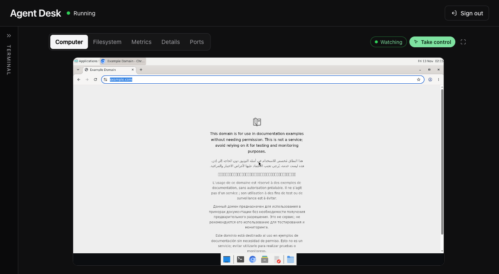

# Agent Desk

A computer for your AI agent, and a clean web page for you to watch it, take over, and see its files.

It is one `docker compose up`: a Linux desktop with a real Chromium on a virtual screen, a shell, a shared
workspace folder, and a single page in front of them. It does not include an agent. Bring any agent that can
drive a browser over CDP, run shell commands, or read and write files.



## What you get

| Tab | What it is |
|---|---|
| **Computer** | The agent's desktop, live, at a fixed 16:9 size. You watch by default; **Take control** lets you click and type (solve a CAPTCHA, sign in), **Hand back** returns it. |
| **Terminal** | A side panel with a shell inside the desktop container. |
| **Filesystem** | The shared workspace as a tree, with a preview of the selected file (text, CSV as a table, PDF, images), upload and download. |
| **Metrics** | CPU, memory, network and disk of the host, last hour to last 24 hours. |
| **Details** | Address, user, workspace path, resources, the shell command and the browser automation address. |
| **Ports** | What is published (only the page) and what stays inside the Docker network. |

The page is behind a password sign-in and listens on `127.0.0.1` by default.

## Quick start

Requires Docker with Compose.

```sh
git clone https://github.com/zmiyajan/agent-desk.git && cd agent-desk
cp .env.example .env
# edit .env and set DESK_PASSWORD (at least 12 characters)
docker compose up -d --build
```

Open <http://127.0.0.1:8080> and sign in. The first build downloads a desktop and a browser, so it takes a few
minutes.

Check it end to end:

```sh
./scripts/smoke-test.sh
```

## Connect your agent

Attach your agent's container to the `agent-desk` network (see [`examples/compose.agent.yml`](examples/compose.agent.yml)).
It then has three ways in. None of them is published on the host.

**1. The browser, over CDP.** Chromium is already open on the desk. Connect to it and you drive the same window
you see in the Computer tab, with the same cookies and logins:

```python
from playwright.sync_api import sync_playwright

with sync_playwright() as p:
    browser = p.chromium.connect_over_cdp("http://desktop:9223")
    page = browser.contexts[0].pages[0]
    page.goto("https://example.com")
```

[`examples/agent_cdp.py`](examples/agent_cdp.py) does the same with no dependencies, to check the connection.

**2. The workspace.** Mount the `agent-desk_workspace` volume in your agent's container. Whatever it writes
shows up in the Filesystem tab and on the desktop, and whatever you upload from the page is there for the agent.

**3. The desktop itself.** Run commands on the desk with `docker compose exec desktop <command>`. Programs that
open a window appear on the screen (`DISPLAY=:1`). The user is `agent`, with `sudo`.

## How it is put together

```
browser ── Caddy :8080 ── auth      password sign-in (every request is checked)
                ├── desktop   Xvnc + Xfce + Chromium; noVNC bridge :6080, ttyd :7681, CDP relay :9223
                ├── files     File Browser, API only
                └── stats     host metrics from /proc, read-only
```

- `desktop/` the agent's computer (Debian, TigerVNC, Xfce, Chromium, ttyd).
- `web/` the page (`index.html`) and the screen viewer (`screen.html`). Plain HTML, CSS and JavaScript, no build step.
- `auth/`, `stats/` two small Python services, standard library only.

## Settings

All in `.env`; see [`.env.example`](.env.example). The ones you are most likely to change: `DESK_PASSWORD`
(required), `DESK_PORT`, `DESK_GEOMETRY`, `DESK_MEMORY`. To rename the page, change `DESK_NAME` in `.env` (sign-in
page) and `DESK_NAME` at the top of the script in `web/index.html` (header).

## Security

Read this before putting it anywhere but your own machine.

- **The page is a shell.** Anyone who signs in can run commands on the desktop container and read the
  workspace. The stack refuses to start without `DESK_PASSWORD`, and binds to loopback.
- **To reach it from elsewhere**, put TLS or a private network in front. [`docs/EXPOSE.md`](docs/EXPOSE.md)
  shows both. Do not publish port 8080 to the internet over plain HTTP.
- **Inside the Docker network nothing asks for a password.** The screen, the terminal and the browser's
  automation port trust every container on the `agent-desk` network. Only attach containers you would give that
  access to.
- **The desktop user has `sudo`, and Chromium runs with `--no-sandbox`.** The container is the boundary. Treat
  what the agent browses as untrusted, and do not mount anything into the desktop that it should not read.
- **Take control is a switch in your viewer.** It does not pause an agent that is acting on the screen at the
  same moment.
- Sessions last 7 days. Five wrong passwords from one address lock sign-in for five minutes.

## Limits

- One desk, one screen, one browser profile per stack.
- Metrics describe the Docker host (on macOS and Windows, Docker's Linux VM), not the container alone.
- Rename, move and delete are done from the desktop's file manager or the terminal; the Filesystem tab browses,
  previews, uploads and downloads.
- Tested end to end with Docker on Linux (amd64). The images also build for arm64.
- Chinese, Japanese and Korean fonts are not installed; add `fonts-noto-cjk` to `desktop/Dockerfile` if you need them.

## License

MIT. See [LICENSE](LICENSE). It bundles nothing: noVNC, TigerVNC, Xfce, Chromium, ttyd, Caddy and File Browser
are installed from their own packages and images under their own licenses.
